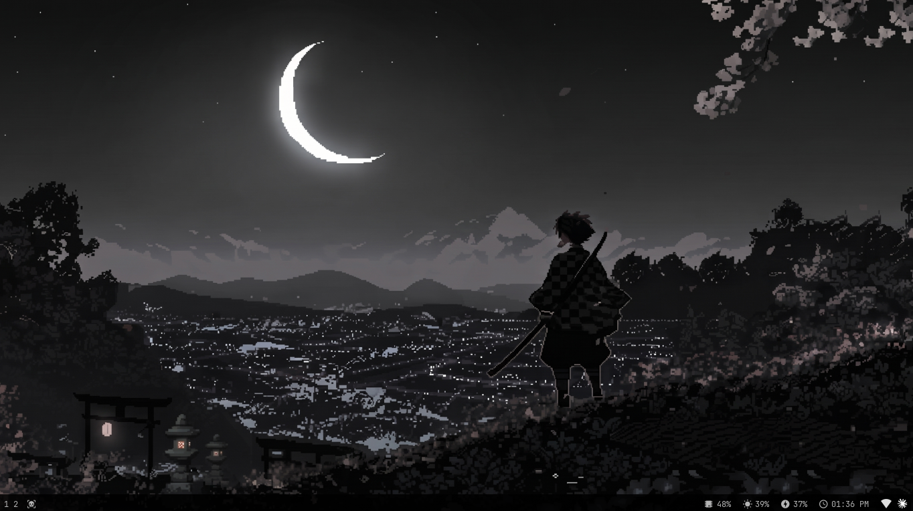
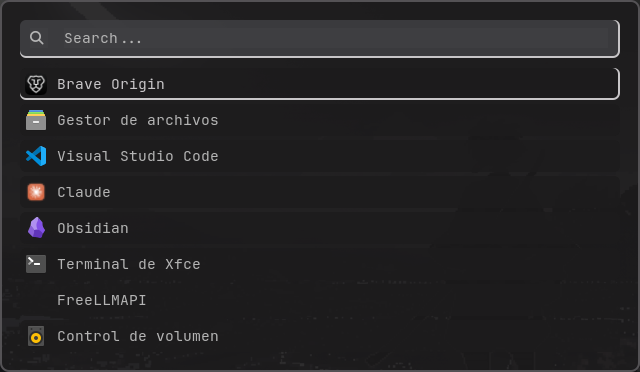

# dotfiles

My personal setup for **MX Linux** with the **i3** window manager and a **Polybar** status bar. I'm a software engineering student, and I keep this repo to document how my environment evolves as I learn.
DESSKTOP / THEME


ROFI / THEME


## What's inside

- `.config/i3/config` – i3 window manager configuration (gaps, borders, workspaces, keybindings, autostart).
- `.config/polybar/config.ini` – Polybar bar layout and colors.
- `.config/polybar/modules.ini` – Polybar modules (workspaces, window title, memory, brightness, battery, date, tray).
- `.config/rofi/config.rasi` – Rofi launcher layout, sizes and widgets.
- `.config/rofi/colors/night.rasi` – Grey color scheme matched to the wallpaper, Polybar and i3 borders.
- `.config/rofi/shared/` – Shared color import and font settings.

## Keybindings

- `Super + D` – application launcher (rofi).
- `Super + Shift + E` – power menu (lock, logout, reboot, shutdown, suspend).
- `Super + Shift + S` – show/hide Polybar.
- `Super + Shift + C` – reload i3.

## Dependencies

Tested on MX Linux (Debian-based). You'll need:

`i3`, `polybar`, `rofi`, `picom`, `feh`, `flameshot`, `brightnessctl`, `network-manager-gnome` (nm-applet), `dex`, `xss-lock`, `i3lock`, `gnome-keyring`

Fonts: **JetBrainsMono Nerd Font** and **Material Icons**.

## Installation

Back up your current config first, then copy the files:

```bash
git clone https://github.com/SamuelLariosR/dotfiles.git
cd dotfiles

mkdir -p ~/.config/i3 ~/.config/polybar ~/.config/rofi
cp .config/i3/config ~/.config/i3/config
cp .config/polybar/*.ini ~/.config/polybar/
cp -r .config/rofi/. ~/.config/rofi/
```

Reload i3 with `Super + Shift + C`.

## Notes

- The mod key is `Super` (`Mod4`).
- The power menu expects `~/bin/powermenu.sh`, a small rofi script kept outside this repo. Without it, `Super + Shift + E` will not open anything.
- Rofi's translucent background needs a compositor (`picom`) running.
- The wallpaper path in the i3 config (`~/Imágenes/WALPA.jpeg`) is mine; point it to your own image.
- This is a work in progress: I'll keep tweaking it as I learn.
